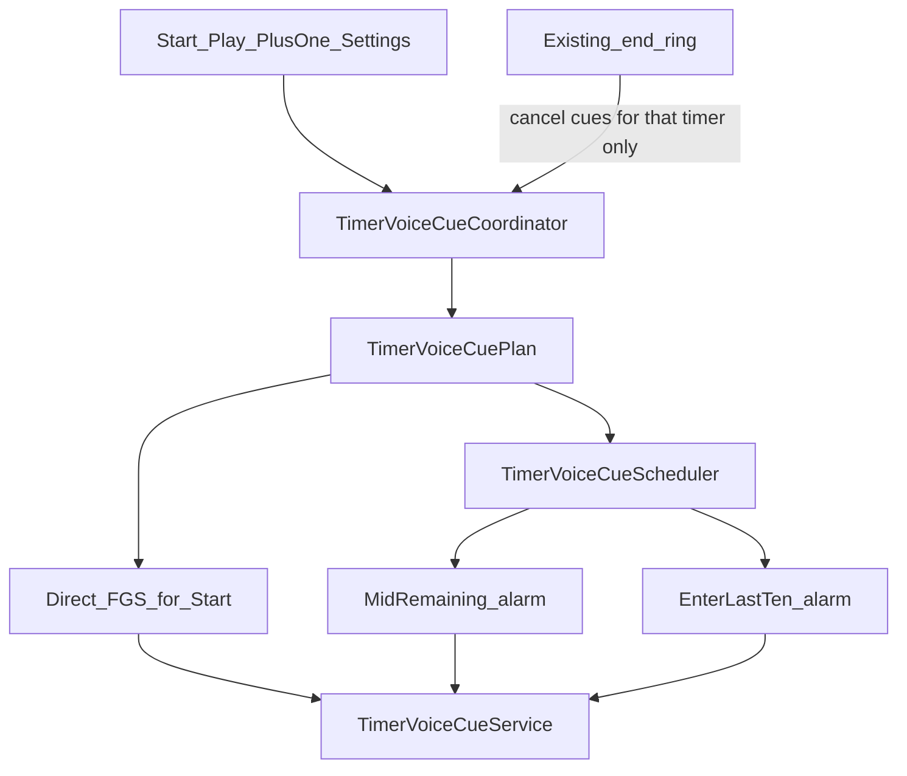
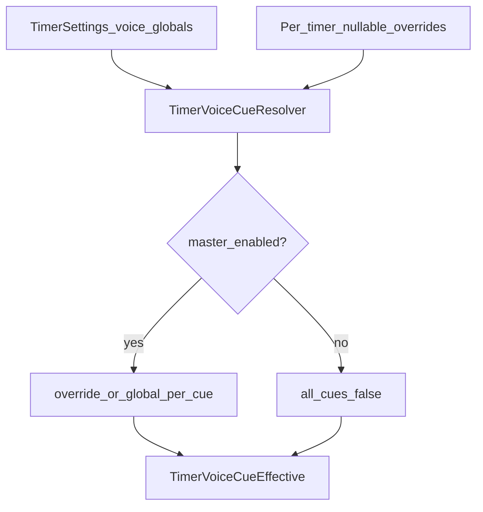
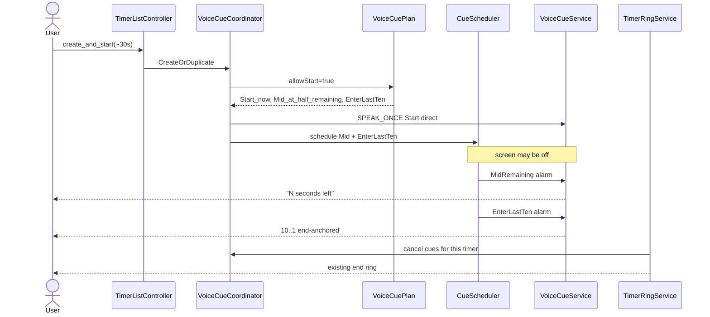
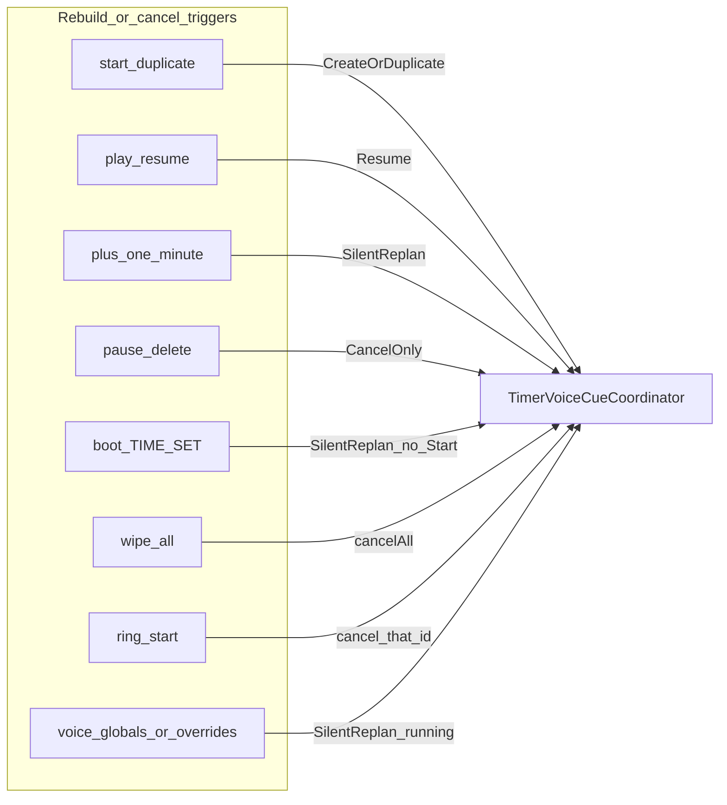
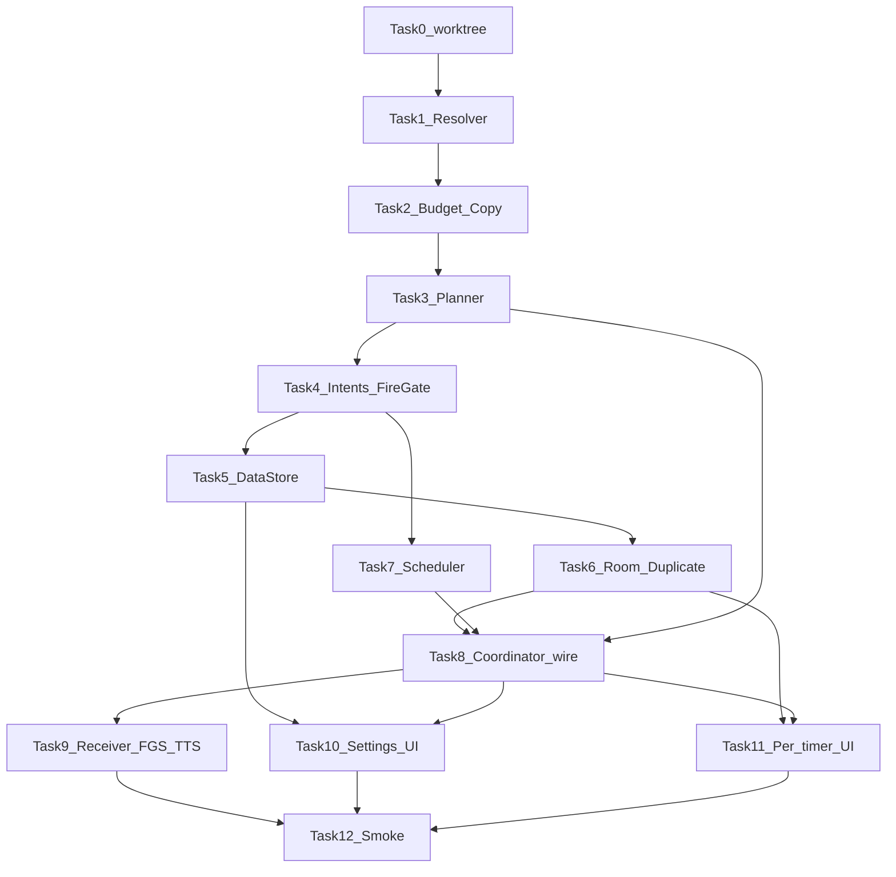

# Timer Voice Cues Implementation Plan

> **For agentic workers:** REQUIRED SUB-SKILL: Use superpowers:subagent-driven-development (recommended) or superpowers:executing-plans to implement this plan task-by-task. Steps use checkbox (`- [ ]`) syntax for tracking.

**Goal:** Ship optional on-device spoken progress cues for countdown timers (Start, mid remaining-time callout, last-10), quiet by default, without changing the zero-time ring.

**Architecture:** Pure domain resolver + planner decide effective cues and fire epochs. A single `TimerVoiceCueCoordinator` cancels/rebuilds from every arm/cancel site. Mid and EnterLastTen use exact-while-idle alarms (never `setAlarmClock`); Start from an interactive path starts `TimerVoiceCueService` directly. The service owns a dedicated `TextToSpeech` instance (not morning Cloud Text-to-Speech (TTS) / persona).

**Tech Stack:** Kotlin, Jetpack Compose, Material 3, Room 27→28, DataStore Preferences, AlarmManager, Foreground Service (FGS) `mediaPlayback`, on-device Android TTS, Hilt, JUnit 4 on the Java Virtual Machine (JVM).

**Slug:** cursor (Composer)

**Spec:** [docs/superpowers/specs/2026-11-19-timer-voice-cues-design.md](../specs/2026-11-19-timer-voice-cues-design.md)

**Fan-out merge map:** [docs/product/research/timer-voice-cues/timer-voice-cues-s2-meta-cursor.md](../../product/research/timer-voice-cues/timer-voice-cues-s2-meta-cursor.md)

## Executive summary

Optional spoken progress on **countdown timers only**. Quiet by default (master off). When enabled, the user can hear three cues while the app is open or screen-off: **Start**, a **mid remaining-time** callout (“N minutes/seconds left”), and a **last-10** digit countdown. The existing zero-time ring path is unchanged.

| | |
|---|---|
| **Why hybrid** | A few AlarmManager cue alarms (never `setAlarmClock`) plus a short `mediaPlayback` Foreground Service (FGS) for speech keeps the end ring’s next-alarm / Do Not Disturb (DND) behavior intact and still works screen-off. |
| **What speaks** | Dedicated on-device Android Text-to-Speech (TTS) inside `TimerVoiceCueService` — not Cloud TTS, not morning persona / `TextToSpeechManager`. |
| **Who decides** | Pure JVM resolver + planner; one `TimerVoiceCueCoordinator` is the only cancel/rebuild door. |
| **Defaults** | Master off; with master on → Start / Mid / Last-10 on; announce-on-resume on. |
| **Hard gates** | Master kills all cues even if a timer override is On; short timers prefer Last-10 over Start; mid is half of **remaining** on each replan. |
| **Data** | Five snake_case DataStore flags; three nullable Room overrides (Inherit / On / Off); migration 27→28. |
| **Verify** | JVM TDD for resolver/planner/budgets/fire gate/URI; device smoke for screen-off last-10. |
| **Out of V1** | Stopwatch callouts, Cloud TTS, cue volume slider, cross-timer speak queue. |
| **Branch** | `feature/timer-voice-cues` from `origin/main` only — not dirty `feature/voice-challenge`. |

**Delivery shape:** Tasks 1–4 pure domain → 5–6 persistence → 7–9 Android schedule/speak → 10–11 UI → 12 smoke. No product code until this plan is approved.

## Diagrams

Prose expands labels used in the diagrams: Foreground Service (FGS), Text-to-Speech (TTS), Do Not Disturb (DND).

### Hybrid cue path vs end ring

End ring stays on `setAlarmClock` when exact alarms are allowed. Cue alarms must never use `setAlarmClock`. Start from an interactive foreground path starts the FGS directly so mid / last-10 keep the allow-while-idle quota.



### Effective cues (master kill switch)



`announceOnResume` is **not** an effective flag. On pause→play the coordinator sets `allowStart = announceOnResume` before calling the planner.

### Milestone timeline (typical ~30s run)



### Coordinator call sites

Every arm/cancel/settings path must go through the coordinator. Non-cue DataStore writes (e.g. ring volume capture) must not.



### Task dependency (implementation order)



## Global Constraints

- **Branch:** Work only on `feature/timer-voice-cues` from `origin/main` (prefer a dedicated worktree). Do **not** implement on dirty `feature/voice-challenge` or any unrelated branch.
- **Master kill switch:** If master is off, every effective cue is false even when a per-timer override is On.
- **Defaults:** Master off; when master is on, Start / Mid remaining / Last-10 default on; **announce-on-resume defaults on**.
- **Resume:** Pause→play speaks Start only when announce-on-resume is on (and short-timer rules allow). Create-and-start / duplicate always may speak Start (subject to short-timer rules). Boot / `TIME_SET` reconcile never emits Start.
- **Short timer:** If Start and LastTen are both effective and remaining is too short for both, **LastTen wins**; Start is suppressed.
- **Mid cue:** Fire at `now + remaining/2` on each replan. Spoken copy is the **time left at fire** (e.g. “5 minutes left”), never the word “halfway”.
- **Speech budgets (locked):** `LAST_TEN_WINDOW_MILLIS = 10_000`; `START_SPEECH_BUDGET_MILLIS = 2_500`; `MID_CLEARANCE_BEFORE_LAST_TEN_MILLIS = 3_000`; `FIRE_LATE_SKEW_MILLIS = 1_500`; `LAST_TEN_DIGIT_SKEW_MILLIS = 400`; `LAST_TEN_WARMUP_LEAD_MILLIS = 800`.
- **Cue path never calls `setAlarmClock`.** Prefer `setExactAndAllowWhileIdle` when exact alarms are allowed; else `setAndAllowWhileIdle` (inexact; late/dropped cues OK).
- **URI:** Cue alarms use `lemurloop://timer-cue/<timerId>/<kind>`; end ring stays `lemurloop://timer/<id>`.
- **FGS:** `TimerVoiceCueService` is `mediaPlayback`, `START_NOT_STICKY`, exported=false. Notification id **222** (not sleep 2, alarm 111, timer finished 220, timer ring 221).
- **TTS:** Dedicated service-scoped `TextToSpeech`; locale from app language setting via configuration context; Hebrew voice missing → English speech + log. Never Cloud TTS / `TextToSpeechManager` / persona.
- **Audibility:** Alarm-adjacent audio attributes / focus. Do not mutate `STREAM_ALARM` volume capture used by the ring. Document platform mute / Do Not Disturb (DND) limits in the service KDoc and device QA note.
- **Duplicate** copies per-timer voice overrides. **Wipe / delete / pause / ring A** cancel that timer’s cues only (wipe cancels all).
- **Non-cue** `timer_settings` writes (e.g. ring volume capture) must **not** rebuild cues.
- **Strings:** Add EN + HE + IW (`values`, `values-he`, `values-iw`); keep HE/IW identical.
- **Room:** Live `@Database` is version **27**; bump to **28**, add `MIGRATION_27_28`, register in `AppModule`.
- **Scope:** Countdown only. No stopwatch, Cloud TTS, configurable last-N, cue volume slider, or cross-timer speak queue. Keep last-10 in V1; degrade only after failed device proof on API 34/35.
- **TDD:** For each domain/data task: failing test → run (red) → minimal code → run (green) → commit. UI wiring may be tests-alongside where no Compose unit harness exists; say so in that task.
- **Local-first UI:** Do not commit user-visible settings/focus UI until the user has seen it on device/emulator and OK’d it (unless they waive).

## Persona review

- **Maintainer:** One coordinator port from every arm/cancel site (controller, boot reconciler, wiper, ring start, voice settings/overrides). Cue intents and schedule-mode helpers must stay distinct from `TimerAlarmIntents` / `timerAlarmScheduleMode` so a future edit cannot accidentally put cues on `setAlarmClock`. Nullable Boolean overrides on `CountdownTimer` must be grepped through every `copy(` / `CountdownTimer(` / `duplicate` path the way alarm options are.
- **Product / UX:** Quiet by default (master off). When master is on, the three cue types and announce-on-resume are on. Mid copy says remaining time, not “halfway”. Per-timer Inherit/On/Off lives on focus/detail, not the keypad. Settings search must open Timer Settings with discoverable voice-cue rows (registry + labels + HE/IW).
- **Reliability:** Fire-time validation drops stale cues; FGS start refusal is caught and logged (no process crash). Multi-timer: cancel A must not `stopSelf` while B’s last-10 is speaking. Deep Doze mid misses are acceptable soft misses; last-10 uses a timed partial wake lock while speaking.
- **QA / testability:** JVM locks resolver (incl. master×override-On→false), planner (half remaining, Mid omit vs last-10+budget, LastTen-vs-Start, reconcile `allowStart=false`), remaining-copy formatter, fire-time predicates, URI/component identity vs end-fire, DataStore defaults, entity round-trip for overrides. Manual matrix: screen-off last-10, master kill vs override On, pause stops speech, announce-on-resume on/off, Hebrew→English TTS fallback.

## File structure

| Path | Responsibility |
|---|---|
| `domain/timer/TimerVoiceCueResolver.kt` | Master kill switch + overrides → effective flags |
| `domain/timer/TimerVoiceCueBudget.kt` | Locked speech/window constants |
| `domain/timer/TimerVoiceCuePlan.kt` | Milestones + skip/collide (pure) |
| `domain/timer/TimerVoiceCueRemainingCopy.kt` | Format remaining duration for mid speech (pure) |
| `domain/timer/TimerVoiceCueFireGate.kt` | Fire-time drop predicates (pure) |
| `domain/timer/TimerVoiceCueIntents.kt` | Cue URI / action / component specs (pure) |
| `domain/timer/TimerVoiceCueCoordinator.kt` | Single cancel/rebuild entry (domain orchestration) |
| `domain/scheduler/TimerVoiceCueScheduler.kt` | Interface: schedule mid / enterLastTen / cancel |
| `data/scheduler/AndroidTimerVoiceCueScheduler.kt` | AlarmManager impl (no `setAlarmClock`) |
| `data/voice/AndroidTimerVoiceCueStarter.kt` | Direct FGS start for Start / mid / last-10 |
| `receiver/TimerVoiceCueReceiver.kt` | Alarm → start FGS (catch refusal) |
| `service/TimerVoiceCueService.kt` | Dedicated TTS FGS; SPEAK_ONCE + LAST_TEN |
| `CountdownTimer` + `TimerEntity` + migration | Three nullable Boolean overrides |
| `TimerSettings` + DataStore repo | Master + three toggles + announce-on-resume |
| `TimerSettingsScreen` / `TimerFocusScreen` / ViewModels | Global + per-timer UI |
| `SettingsSearch*` + strings EN/HE/IW | Discoverability |
| Tests under `app/src/test/...` | JVM contracts above |

---

### Task 0: Branch / worktree (no product code)

**Files:** none (git only). Bring docs onto the branch when committing the first code task, or commit docs-only first if preferred.

- [ ] **Step 1: Inspect checkout**

```bash
cd /Users/elroi/Developer/LemurLoop
git status -sb
git worktree list
git fetch origin main
```

If this tree is on dirty `feature/voice-challenge` (or any unrelated dirty branch), **do not switch it**. Create a sibling worktree:

```bash
git worktree add -b feature/timer-voice-cues \
  /Users/elroi/Developer/LemurLoop-timer-voice-cues \
  origin/main
cd /Users/elroi/Developer/LemurLoop-timer-voice-cues
```

Symlink or copy gitignored `local.properties` from the primary checkout so Gradle can find the Software Development Kit (SDK). Copy onto the new worktree (if not already on `origin/main`):

- `docs/superpowers/specs/2026-11-19-timer-voice-cues-design.md`
- `docs/product/research/timer-voice-cues/`
- `docs/superpowers/plans/2026-11-21-timer-voice-cues.md`

Do **not** copy voice-challenge source changes.

- [ ] **Step 2: Confirm base**

```bash
git rev-parse --abbrev-ref HEAD   # feature/timer-voice-cues
git merge-base --is-ancestor origin/main HEAD && echo ok
```

Expected: branch name `feature/timer-voice-cues`; merge-base check prints `ok`.

---

### Task 1: Resolver (master kill switch)

**Files:**
- Create: `app/src/test/java/com/elroi/lemurloop/domain/timer/TimerVoiceCueResolverTest.kt`
- Create: `app/src/main/java/com/elroi/lemurloop/domain/timer/TimerVoiceCueResolver.kt`

**Interfaces:**
- Consumes: none beyond Kotlin stdlib.
- Produces:

```kotlin
data class TimerVoiceCueOverrides(
    val start: Boolean? = null,
    val midRemaining: Boolean? = null,
    val lastTen: Boolean? = null
)

data class TimerVoiceCueGlobals(
    val masterEnabled: Boolean,
    val startEnabled: Boolean,
    val midRemainingEnabled: Boolean,
    val lastTenEnabled: Boolean,
    val announceOnResume: Boolean
)

data class TimerVoiceCueEffective(
    val start: Boolean,
    val midRemaining: Boolean,
    val lastTen: Boolean
)

object TimerVoiceCueResolver {
    fun effective(globals: TimerVoiceCueGlobals, overrides: TimerVoiceCueOverrides): TimerVoiceCueEffective
}
```

Rule: `if (!master) all false; else override ?: globalToggle` per cue. `announceOnResume` is **not** part of effective flags (coordinator uses it when choosing `allowStart` on play).

- [ ] **Step 1: Write the failing test**

```kotlin
package com.elroi.lemurloop.domain.timer

import org.junit.Assert.assertFalse
import org.junit.Assert.assertTrue
import org.junit.Test

class TimerVoiceCueResolverTest {

    private val globalsOn = TimerVoiceCueGlobals(
        masterEnabled = true,
        startEnabled = true,
        midRemainingEnabled = true,
        lastTenEnabled = true,
        announceOnResume = true
    )

    @Test
    fun effective_masterOff_overrideOn_isStillFalse() {
        val effective = TimerVoiceCueResolver.effective(
            globals = globalsOn.copy(masterEnabled = false),
            overrides = TimerVoiceCueOverrides(start = true, midRemaining = true, lastTen = true)
        )
        assertFalse(effective.start)
        assertFalse(effective.midRemaining)
        assertFalse(effective.lastTen)
    }

    @Test
    fun effective_masterOn_overrideOff_disablesOnlyThatCue() {
        val effective = TimerVoiceCueResolver.effective(
            globals = globalsOn,
            overrides = TimerVoiceCueOverrides(start = false, midRemaining = null, lastTen = null)
        )
        assertFalse(effective.start)
        assertTrue(effective.midRemaining)
        assertTrue(effective.lastTen)
    }

    @Test
    fun effective_masterOn_inherit_usesGlobalToggles() {
        val effective = TimerVoiceCueResolver.effective(
            globals = globalsOn.copy(startEnabled = false, midRemainingEnabled = true, lastTenEnabled = false),
            overrides = TimerVoiceCueOverrides()
        )
        assertFalse(effective.start)
        assertTrue(effective.midRemaining)
        assertFalse(effective.lastTen)
    }

    @Test
    fun announceOnResume_isNotAnEffectiveCueFlag() {
        // Documented contract: resume gating is coordinator-side via allowStart.
        val a = TimerVoiceCueResolver.effective(globalsOn.copy(announceOnResume = true), TimerVoiceCueOverrides())
        val b = TimerVoiceCueResolver.effective(globalsOn.copy(announceOnResume = false), TimerVoiceCueOverrides())
        assertTrue(a.start && b.start && a.midRemaining && b.midRemaining && a.lastTen && b.lastTen)
    }
}
```

- [ ] **Step 2: Run test to verify it fails**

```bash
./gradlew :app:testDebugUnitTest --tests "com.elroi.lemurloop.domain.timer.TimerVoiceCueResolverTest"
```

Expected: FAIL (types / object missing).

- [ ] **Step 3: Write minimal implementation**

```kotlin
package com.elroi.lemurloop.domain.timer

data class TimerVoiceCueOverrides(
    val start: Boolean? = null,
    val midRemaining: Boolean? = null,
    val lastTen: Boolean? = null
)

data class TimerVoiceCueGlobals(
    val masterEnabled: Boolean,
    val startEnabled: Boolean,
    val midRemainingEnabled: Boolean,
    val lastTenEnabled: Boolean,
    val announceOnResume: Boolean
)

data class TimerVoiceCueEffective(
    val start: Boolean,
    val midRemaining: Boolean,
    val lastTen: Boolean
)

object TimerVoiceCueResolver {
    fun effective(
        globals: TimerVoiceCueGlobals,
        overrides: TimerVoiceCueOverrides
    ): TimerVoiceCueEffective {
        if (!globals.masterEnabled) {
            return TimerVoiceCueEffective(start = false, midRemaining = false, lastTen = false)
        }
        return TimerVoiceCueEffective(
            start = overrides.start ?: globals.startEnabled,
            midRemaining = overrides.midRemaining ?: globals.midRemainingEnabled,
            lastTen = overrides.lastTen ?: globals.lastTenEnabled
        )
    }
}
```

- [ ] **Step 4: Run test to verify it passes**

Same Gradle command. Expected: PASS.

- [ ] **Step 5: Commit**

```bash
git add app/src/main/java/com/elroi/lemurloop/domain/timer/TimerVoiceCueResolver.kt \
  app/src/test/java/com/elroi/lemurloop/domain/timer/TimerVoiceCueResolverTest.kt
git commit -m "$(cat <<'EOF'
feat(timer): add voice cue resolver with master kill switch

EOF
)"
```

---

### Task 2: Speech budget constants + remaining-time copy

**Files:**
- Create: `app/src/main/java/com/elroi/lemurloop/domain/timer/TimerVoiceCueBudget.kt`
- Create: `app/src/main/java/com/elroi/lemurloop/domain/timer/TimerVoiceCueRemainingCopy.kt`
- Create: `app/src/test/java/com/elroi/lemurloop/domain/timer/TimerVoiceCueRemainingCopyTest.kt`

**Interfaces:**
- Consumes: none.
- Produces: `object TimerVoiceCueBudget` with the Global Constraints constants; `object TimerVoiceCueRemainingCopy { fun english(remainingMillis: Long): String }` for JVM-tested English tokens. (Localized string resources for device speech come in the service task; this helper locks the numeric wording contract the planner/service share.)

- [ ] **Step 1: Write the failing test**

```kotlin
package com.elroi.lemurloop.domain.timer

import org.junit.Assert.assertEquals
import org.junit.Assert.assertFalse
import org.junit.Test

class TimerVoiceCueRemainingCopyTest {

    @Test
    fun english_fiveMinutes_left() {
        assertEquals("5 minutes left", TimerVoiceCueRemainingCopy.english(5 * 60_000L))
    }

    @Test
    fun english_oneMinute_singular() {
        assertEquals("1 minute left", TimerVoiceCueRemainingCopy.english(60_000L))
    }

    @Test
    fun english_thirtySeconds_left() {
        assertEquals("30 seconds left", TimerVoiceCueRemainingCopy.english(30_000L))
    }

    @Test
    fun english_oneSecond_singular() {
        assertEquals("1 second left", TimerVoiceCueRemainingCopy.english(1_000L))
    }

    @Test
    fun english_neverSaysHalfway() {
        val text = TimerVoiceCueRemainingCopy.english(120_000L)
        assertFalse(text.contains("halfway", ignoreCase = true))
        assertEquals("2 minutes left", text)
    }

    @Test
    fun budget_constants_matchPlanLocks() {
        assertEquals(10_000L, TimerVoiceCueBudget.LAST_TEN_WINDOW_MILLIS)
        assertEquals(2_500L, TimerVoiceCueBudget.START_SPEECH_BUDGET_MILLIS)
        assertEquals(3_000L, TimerVoiceCueBudget.MID_CLEARANCE_BEFORE_LAST_TEN_MILLIS)
        assertEquals(1_500L, TimerVoiceCueBudget.FIRE_LATE_SKEW_MILLIS)
        assertEquals(400L, TimerVoiceCueBudget.LAST_TEN_DIGIT_SKEW_MILLIS)
        assertEquals(800L, TimerVoiceCueBudget.LAST_TEN_WARMUP_LEAD_MILLIS)
    }
}
```

Rounding rule for the helper: use whole seconds `ceil` of `remainingMillis / 1000.0` for sub-minute; for ≥ 60s speak whole minutes via `floor(remainingMillis / 60_000)` (drop leftover seconds). Zero or negative → `"0 seconds left"`.

- [ ] **Step 2: Run test — expect FAIL**

```bash
./gradlew :app:testDebugUnitTest --tests "com.elroi.lemurloop.domain.timer.TimerVoiceCueRemainingCopyTest"
```

- [ ] **Step 3: Implement**

```kotlin
package com.elroi.lemurloop.domain.timer

object TimerVoiceCueBudget {
    const val LAST_TEN_WINDOW_MILLIS = 10_000L
    const val START_SPEECH_BUDGET_MILLIS = 2_500L
    const val MID_CLEARANCE_BEFORE_LAST_TEN_MILLIS = 3_000L
    const val FIRE_LATE_SKEW_MILLIS = 1_500L
    const val LAST_TEN_DIGIT_SKEW_MILLIS = 400L
    const val LAST_TEN_WARMUP_LEAD_MILLIS = 800L
}
```

```kotlin
package com.elroi.lemurloop.domain.timer

import kotlin.math.ceil

object TimerVoiceCueRemainingCopy {
    fun english(remainingMillis: Long): String {
        if (remainingMillis <= 0L) return "0 seconds left"
        if (remainingMillis >= 60_000L) {
            val minutes = remainingMillis / 60_000L
            return if (minutes == 1L) "1 minute left" else "$minutes minutes left"
        }
        val seconds = ceil(remainingMillis / 1000.0).toLong().coerceAtLeast(1L)
        return if (seconds == 1L) "1 second left" else "$seconds seconds left"
    }
}
```

- [ ] **Step 4: Run — expect PASS**

- [ ] **Step 5: Commit**

```bash
git add app/src/main/java/com/elroi/lemurloop/domain/timer/TimerVoiceCueBudget.kt \
  app/src/main/java/com/elroi/lemurloop/domain/timer/TimerVoiceCueRemainingCopy.kt \
  app/src/test/java/com/elroi/lemurloop/domain/timer/TimerVoiceCueRemainingCopyTest.kt
git commit -m "$(cat <<'EOF'
feat(timer): lock voice cue speech budgets and remaining copy

EOF
)"
```

---

### Task 3: Planner (half remaining, LastTen vs Start, reconcile)

**Files:**
- Create: `app/src/main/java/com/elroi/lemurloop/domain/timer/TimerVoiceCuePlan.kt`
- Create: `app/src/test/java/com/elroi/lemurloop/domain/timer/TimerVoiceCuePlanTest.kt`

**Interfaces:**
- Consumes: `TimerVoiceCueEffective`, `TimerVoiceCueBudget`.
- Produces:

```kotlin
enum class TimerVoiceCueKind { Start, MidRemaining, EnterLastTen }

data class TimerVoiceCueMilestone(
    val kind: TimerVoiceCueKind,
    val fireAtEpochMillis: Long
)

data class TimerVoiceCuePlanInput(
    val nowEpochMillis: Long,
    val endsAtEpochMillis: Long,
    val effective: TimerVoiceCueEffective,
    val allowStart: Boolean
)

object TimerVoiceCuePlan {
    fun plan(input: TimerVoiceCuePlanInput): List<TimerVoiceCueMilestone>
}
```

Rules to encode:

1. `remaining = endsAt - now`; if `remaining <= 0` → empty plan.
2. **EnterLastTen:** if `effective.lastTen`:
   - if `remaining <= LAST_TEN_WINDOW` → milestone at `now` (immediate).
   - else → at `endsAt - LAST_TEN_WINDOW` (optionally minus warm-up is a **service** concern; planner uses window start).
3. **MidRemaining:** if `effective.midRemaining`: `midAt = now + remaining/2`. Omit if `midAt >= endsAt - LAST_TEN_WINDOW - MID_CLEARANCE` (collides with last-10 + budget). Also omit if `midAt <= now` (would be immediate nonsense on tiny remainders — treat as omit).
4. **Start:** include at `now` only if `allowStart && effective.start`. If Start and LastTen both wanted and `remaining <= LAST_TEN_WINDOW + START_SPEECH_BUDGET`, **omit Start** (LastTen wins).
5. Return milestones sorted by `fireAtEpochMillis`, then kind ordinal.

- [ ] **Step 1: Write the failing test**

```kotlin
package com.elroi.lemurloop.domain.timer

import org.junit.Assert.assertEquals
import org.junit.Assert.assertTrue
import org.junit.Test

class TimerVoiceCuePlanTest {

    private val now = 1_000_000L
    private val allOn = TimerVoiceCueEffective(start = true, midRemaining = true, lastTen = true)

    private fun input(
        remaining: Long,
        effective: TimerVoiceCueEffective = allOn,
        allowStart: Boolean = true
    ) = TimerVoiceCuePlanInput(
        nowEpochMillis = now,
        endsAtEpochMillis = now + remaining,
        effective = effective,
        allowStart = allowStart
    )

    @Test
    fun plan_thirtySeconds_midAtHalfRemaining() {
        val plan = TimerVoiceCuePlan.plan(input(30_000L))
        val mid = plan.single { it.kind == TimerVoiceCueKind.MidRemaining }
        assertEquals(now + 15_000L, mid.fireAtEpochMillis)
    }

    @Test
    fun plan_omitMid_whenInsideLastTenPlusClearance() {
        // remaining 20s: mid at +10s; last-10 starts at +10s; clearance 3s → mid omitted
        val plan = TimerVoiceCuePlan.plan(input(20_000L))
        assertTrue(plan.none { it.kind == TimerVoiceCueKind.MidRemaining })
        assertTrue(plan.any { it.kind == TimerVoiceCueKind.EnterLastTen })
    }

    @Test
    fun plan_shortTimer_lastTenWins_startSuppressed() {
        val plan = TimerVoiceCuePlan.plan(input(8_000L, allowStart = true))
        assertTrue(plan.none { it.kind == TimerVoiceCueKind.Start })
        assertEquals(
            listOf(TimerVoiceCueKind.EnterLastTen),
            plan.map { it.kind }
        )
        assertEquals(now, plan.single().fireAtEpochMillis)
    }

    @Test
    fun plan_reconcile_allowStartFalse_omitsStart() {
        val plan = TimerVoiceCuePlan.plan(input(120_000L, allowStart = false))
        assertTrue(plan.none { it.kind == TimerVoiceCueKind.Start })
        assertTrue(plan.any { it.kind == TimerVoiceCueKind.MidRemaining })
        assertTrue(plan.any { it.kind == TimerVoiceCueKind.EnterLastTen })
    }

    @Test
    fun plan_createStart_includesStartWhenBudgetAllows() {
        val plan = TimerVoiceCuePlan.plan(input(120_000L, allowStart = true))
        assertTrue(plan.any { it.kind == TimerVoiceCueKind.Start && it.fireAtEpochMillis == now })
    }

    @Test
    fun plan_plusOneReplan_midUsesHalfOfNewRemaining() {
        // Simulate post-+1:00 remaining 5 minutes → mid at +2.5 min from now
        val plan = TimerVoiceCuePlan.plan(input(5 * 60_000L, allowStart = false))
        val mid = plan.single { it.kind == TimerVoiceCueKind.MidRemaining }
        assertEquals(now + 150_000L, mid.fireAtEpochMillis)
    }
}
```

- [ ] **Step 2: Run — expect FAIL**

```bash
./gradlew :app:testDebugUnitTest --tests "com.elroi.lemurloop.domain.timer.TimerVoiceCuePlanTest"
```

- [ ] **Step 3: Implement `TimerVoiceCuePlan`**

```kotlin
package com.elroi.lemurloop.domain.timer

enum class TimerVoiceCueKind { Start, MidRemaining, EnterLastTen }

data class TimerVoiceCueMilestone(
    val kind: TimerVoiceCueKind,
    val fireAtEpochMillis: Long
)

data class TimerVoiceCuePlanInput(
    val nowEpochMillis: Long,
    val endsAtEpochMillis: Long,
    val effective: TimerVoiceCueEffective,
    val allowStart: Boolean
)

object TimerVoiceCuePlan {
    fun plan(input: TimerVoiceCuePlanInput): List<TimerVoiceCueMilestone> {
        val remaining = input.endsAtEpochMillis - input.nowEpochMillis
        if (remaining <= 0L) return emptyList()

        val out = ArrayList<TimerVoiceCueMilestone>(3)

        val lastTenWanted = input.effective.lastTen
        val startWanted = input.allowStart && input.effective.start
        val startSuppressedByLastTen = startWanted && lastTenWanted &&
            remaining <= TimerVoiceCueBudget.LAST_TEN_WINDOW_MILLIS +
            TimerVoiceCueBudget.START_SPEECH_BUDGET_MILLIS

        if (startWanted && !startSuppressedByLastTen) {
            out += TimerVoiceCueMilestone(TimerVoiceCueKind.Start, input.nowEpochMillis)
        }

        if (input.effective.midRemaining) {
            val midAt = input.nowEpochMillis + remaining / 2L
            val lastTenStart = input.endsAtEpochMillis - TimerVoiceCueBudget.LAST_TEN_WINDOW_MILLIS
            val midDeadline = lastTenStart - TimerVoiceCueBudget.MID_CLEARANCE_BEFORE_LAST_TEN_MILLIS
            if (midAt > input.nowEpochMillis && midAt < midDeadline) {
                out += TimerVoiceCueMilestone(TimerVoiceCueKind.MidRemaining, midAt)
            }
        }

        if (lastTenWanted) {
            val enterAt = if (remaining <= TimerVoiceCueBudget.LAST_TEN_WINDOW_MILLIS) {
                input.nowEpochMillis
            } else {
                input.endsAtEpochMillis - TimerVoiceCueBudget.LAST_TEN_WINDOW_MILLIS
            }
            out += TimerVoiceCueMilestone(TimerVoiceCueKind.EnterLastTen, enterAt)
        }

        return out.sortedWith(
            compareBy<TimerVoiceCueMilestone> { it.fireAtEpochMillis }
                .thenBy { it.kind.ordinal }
        )
    }
}
```

- [ ] **Step 4: Run — expect PASS**

- [ ] **Step 5: Commit**

```bash
git add app/src/main/java/com/elroi/lemurloop/domain/timer/TimerVoiceCuePlan.kt \
  app/src/test/java/com/elroi/lemurloop/domain/timer/TimerVoiceCuePlanTest.kt
git commit -m "$(cat <<'EOF'
feat(timer): plan voice cue milestones with LastTen-vs-Start rules

EOF
)"
```

---

### Task 4: Cue intents + fire-time gate + schedule mode

**Files:**
- Create: `app/src/main/java/com/elroi/lemurloop/domain/timer/TimerVoiceCueIntents.kt`
- Create: `app/src/main/java/com/elroi/lemurloop/domain/timer/TimerVoiceCueFireGate.kt`
- Create: `app/src/test/java/com/elroi/lemurloop/domain/timer/TimerVoiceCueIntentsTest.kt`
- Create: `app/src/test/java/com/elroi/lemurloop/domain/timer/TimerVoiceCueFireGateTest.kt`

**Interfaces:**
- Consumes: `TimerVoiceCueKind`, `TimerVoiceCueBudget`, existing `TimerAlarmIntents` (for contrast only).
- Produces:

```kotlin
// TimerVoiceCueIntents — dataUri "lemurloop://timer-cue/<id>/<kind>",
// FIRE_ACTION, FIRE_COMPONENT = TimerVoiceCueReceiver FQCN,
// parse timerId + kind; never share prefix parse with TimerAlarmIntents.timerId

enum class TimerVoiceCueScheduleMode { SetExactAndAllowWhileIdle, SetAndAllowWhileIdle }

fun timerVoiceCueScheduleMode(sdkInt: Int, canScheduleExactAlarms: Boolean): TimerVoiceCueScheduleMode

object TimerVoiceCueFireGate {
    fun shouldSpeak(
        nowEpochMillis: Long,
        scheduledFireEpochMillis: Long,
        endsAtEpochMillis: Long,
        phaseIsRunning: Boolean,
        endsAtUnchanged: Boolean,
        cueStillEffective: Boolean
    ): Boolean

    fun lastTenDigitsToSpeak(nowEpochMillis: Long, endsAtEpochMillis: Long): List<Int>
}
```

`shouldSpeak`: false if not running, end changed, cue ineffective, or `now > scheduledFire + FIRE_LATE_SKEW`.  
`lastTenDigitsToSpeak`: integers from `min(10, ceil(remaining/1000))` down to 1, skipping any digit whose ideal epoch (`endsAt - digit*1000`) is already more than `LAST_TEN_DIGIT_SKEW` in the past; empty if at/past end.

- [ ] **Step 1: Write failing tests**

```kotlin
package com.elroi.lemurloop.domain.timer

import org.junit.Assert.assertEquals
import org.junit.Assert.assertNull
import org.junit.Assert.assertTrue
import org.junit.Test

class TimerVoiceCueIntentsTest {

    @Test
    fun dataUri_isDistinctFromEndRingPrefix() {
        val uri = TimerVoiceCueIntents.dataUri(7L, TimerVoiceCueKind.MidRemaining)
        assertEquals("lemurloop://timer-cue/7/MidRemaining", uri)
        assertNull(TimerAlarmIntents.timerId(uri))
    }

    @Test
    fun parse_roundTripsIdAndKind() {
        val uri = TimerVoiceCueIntents.dataUri(42L, TimerVoiceCueKind.EnterLastTen)
        assertEquals(42L, TimerVoiceCueIntents.timerId(uri))
        assertEquals(TimerVoiceCueKind.EnterLastTen, TimerVoiceCueIntents.kind(uri))
    }

    @Test
    fun fire_targetsVoiceCueReceiver() {
        val spec = TimerVoiceCueIntents.fire(3L, TimerVoiceCueKind.MidRemaining)
        assertEquals("com.elroi.lemurloop.receiver.TimerVoiceCueReceiver", spec.componentClassName)
        assertEquals(TimerVoiceCueIntents.FIRE_ACTION, spec.action)
        assertEquals("lemurloop://timer-cue/3/MidRemaining", spec.dataUri)
    }

    @Test
    fun scheduleMode_neverUsesSetAlarmClock() {
        assertEquals(
            TimerVoiceCueScheduleMode.SetExactAndAllowWhileIdle,
            timerVoiceCueScheduleMode(sdkInt = 34, canScheduleExactAlarms = true)
        )
        assertEquals(
            TimerVoiceCueScheduleMode.SetAndAllowWhileIdle,
            timerVoiceCueScheduleMode(sdkInt = 34, canScheduleExactAlarms = false)
        )
        assertTrue(
            TimerVoiceCueScheduleMode.entries.none { it.name.contains("AlarmClock", ignoreCase = true) }
        )
    }
}
```

```kotlin
package com.elroi.lemurloop.domain.timer

import org.junit.Assert.assertEquals
import org.junit.Assert.assertFalse
import org.junit.Assert.assertTrue
import org.junit.Test

class TimerVoiceCueFireGateTest {

    @Test
    fun shouldSpeak_falseWhenLaterThanSkew() {
        assertFalse(
            TimerVoiceCueFireGate.shouldSpeak(
                nowEpochMillis = 10_000L,
                scheduledFireEpochMillis = 8_000L,
                endsAtEpochMillis = 20_000L,
                phaseIsRunning = true,
                endsAtUnchanged = true,
                cueStillEffective = true
            )
        )
    }

    @Test
    fun shouldSpeak_trueWithinSkew() {
        assertTrue(
            TimerVoiceCueFireGate.shouldSpeak(
                nowEpochMillis = 8_500L,
                scheduledFireEpochMillis = 8_000L,
                endsAtEpochMillis = 20_000L,
                phaseIsRunning = true,
                endsAtUnchanged = true,
                cueStillEffective = true
            )
        )
    }

    @Test
    fun lastTenDigits_skipsLateAndStopsAtEnd() {
        val ends = 100_000L
        // 3.2s left → ideal digits 4..1 but 4 is late beyond skew → 3,2,1
        assertEquals(
            listOf(3, 2, 1),
            TimerVoiceCueFireGate.lastTenDigitsToSpeak(nowEpochMillis = ends - 3_200L, endsAtEpochMillis = ends)
        )
        assertEquals(
            emptyList<Int>(),
            TimerVoiceCueFireGate.lastTenDigitsToSpeak(nowEpochMillis = ends, endsAtEpochMillis = ends)
        )
    }
}
```

- [ ] **Step 2: Run — FAIL**

```bash
./gradlew :app:testDebugUnitTest --tests "com.elroi.lemurloop.domain.timer.TimerVoiceCueIntentsTest" \
  --tests "com.elroi.lemurloop.domain.timer.TimerVoiceCueFireGateTest"
```

- [ ] **Step 3: Implement**

```kotlin
package com.elroi.lemurloop.domain.timer

data class TimerVoiceCueIntentSpec(
    val dataUri: String,
    val action: String,
    val requestCode: Int,
    val componentClassName: String
)

object TimerVoiceCueIntents {
    const val FIRE_ACTION = "com.elroi.lemurloop.action.TIMER_VOICE_CUE"
    const val FIRE_COMPONENT = "com.elroi.lemurloop.receiver.TimerVoiceCueReceiver"
    private const val DATA_PREFIX = "lemurloop://timer-cue/"

    fun dataUri(timerId: Long, kind: TimerVoiceCueKind): String = "$DATA_PREFIX$timerId/${kind.name}"

    fun fire(timerId: Long, kind: TimerVoiceCueKind) = TimerVoiceCueIntentSpec(
        dataUri = dataUri(timerId, kind),
        action = FIRE_ACTION,
        requestCode = kind.ordinal,
        componentClassName = FIRE_COMPONENT
    )

    fun timerId(uri: String?): Long? {
        if (uri == null || !uri.startsWith(DATA_PREFIX)) return null
        return uri.removePrefix(DATA_PREFIX).substringBefore('/').toLongOrNull()
    }

    fun kind(uri: String?): TimerVoiceCueKind? {
        if (uri == null || !uri.startsWith(DATA_PREFIX)) return null
        val name = uri.removePrefix(DATA_PREFIX).substringAfter('/', missingDelimiterValue = "")
        return runCatching { TimerVoiceCueKind.valueOf(name) }.getOrNull()
    }
}

enum class TimerVoiceCueScheduleMode {
    SetExactAndAllowWhileIdle,
    SetAndAllowWhileIdle
}

fun timerVoiceCueScheduleMode(sdkInt: Int, canScheduleExactAlarms: Boolean): TimerVoiceCueScheduleMode {
    return if (sdkInt < 31 || canScheduleExactAlarms) {
        TimerVoiceCueScheduleMode.SetExactAndAllowWhileIdle
    } else {
        TimerVoiceCueScheduleMode.SetAndAllowWhileIdle
    }
}
```

```kotlin
package com.elroi.lemurloop.domain.timer

import kotlin.math.ceil

object TimerVoiceCueFireGate {
    fun shouldSpeak(
        nowEpochMillis: Long,
        scheduledFireEpochMillis: Long,
        endsAtEpochMillis: Long,
        phaseIsRunning: Boolean,
        endsAtUnchanged: Boolean,
        cueStillEffective: Boolean
    ): Boolean {
        if (!phaseIsRunning || !endsAtUnchanged || !cueStillEffective) return false
        if (nowEpochMillis >= endsAtEpochMillis) return false
        return nowEpochMillis <= scheduledFireEpochMillis + TimerVoiceCueBudget.FIRE_LATE_SKEW_MILLIS
    }

    fun lastTenDigitsToSpeak(nowEpochMillis: Long, endsAtEpochMillis: Long): List<Int> {
        val remaining = endsAtEpochMillis - nowEpochMillis
        if (remaining <= 0L) return emptyList()
        val top = ceil(remaining / 1000.0).toInt().coerceIn(1, 10)
        return (top downTo 1).filter { digit ->
            val ideal = endsAtEpochMillis - digit * 1_000L
            nowEpochMillis <= ideal + TimerVoiceCueBudget.LAST_TEN_DIGIT_SKEW_MILLIS
        }
    }
}
```

- [ ] **Step 4: Run — PASS**

- [ ] **Step 5: Commit**

```bash
git add app/src/main/java/com/elroi/lemurloop/domain/timer/TimerVoiceCueIntents.kt \
  app/src/main/java/com/elroi/lemurloop/domain/timer/TimerVoiceCueFireGate.kt \
  app/src/test/java/com/elroi/lemurloop/domain/timer/TimerVoiceCueIntentsTest.kt \
  app/src/test/java/com/elroi/lemurloop/domain/timer/TimerVoiceCueFireGateTest.kt
git commit -m "$(cat <<'EOF'
feat(timer): add voice cue intents, schedule mode, and fire gate

EOF
)"
```

---

### Task 5: DataStore globals (snake_case)

**Files:**
- Modify: `app/src/main/java/com/elroi/lemurloop/domain/timer/TimerSettings.kt`
- Modify: `app/src/main/java/com/elroi/lemurloop/data/repository/TimerSettingsRepositoryImpl.kt`
- Modify: `app/src/test/java/com/elroi/lemurloop/data/repository/TimerSettingsRepositoryImplTest.kt`

**Interfaces:**
- Extend `TimerSettings` with:

```kotlin
val voiceCuesMasterEnabled: Boolean = false,
val voiceCueStartEnabled: Boolean = true,
val voiceCueMidRemainingEnabled: Boolean = true,
val voiceCueLastTenEnabled: Boolean = true,
val voiceCueAnnounceOnResume: Boolean = true
```

Preference keys (snake_case): `voice_cues_master_enabled`, `voice_cue_start_enabled`, `voice_cue_mid_remaining_enabled`, `voice_cue_last_ten_enabled`, `voice_cue_announce_on_resume`.

Add `fun toVoiceCueGlobals(): TimerVoiceCueGlobals` on `TimerSettings`.

- [ ] **Step 1: Extend failing/updated tests**

In `TimerSettingsRepositoryImplTest`:

- `get_emptyStore_usesTheTimerDefaults` must assert the five voice defaults above.
- Add `update_thenGet_roundTripsVoiceCueFlags` flipping master on and announce-on-resume off.

- [ ] **Step 2: Run — expect FAIL** (defaults / missing fields)

```bash
./gradlew :app:testDebugUnitTest --tests "com.elroi.lemurloop.data.repository.TimerSettingsRepositoryImplTest"
```

- [ ] **Step 3: Implement fields + read/write keys**

- [ ] **Step 4: Run — PASS**

- [ ] **Step 5: Commit**

```bash
git commit -m "$(cat <<'EOF'
feat(timer): persist voice cue globals in timer_settings DataStore

EOF
)"
```

---

### Task 6: Room overrides + migration 27→28 + duplicate copy

**Files:**
- Modify: `app/src/main/java/com/elroi/lemurloop/domain/timer/CountdownTimer.kt`
- Modify: `app/src/main/java/com/elroi/lemurloop/data/local/entity/TimerEntity.kt`
- Modify: `app/src/main/java/com/elroi/lemurloop/data/local/AppDatabase.kt` (version 28 + `MIGRATION_27_28`)
- Modify: `app/src/main/java/com/elroi/lemurloop/di/AppModule.kt` (`addMigrations`)
- Modify: `app/src/main/java/com/elroi/lemurloop/domain/timer/TimerTransitions.kt` (`duplicate` copies overrides)
- Modify: `app/src/test/java/com/elroi/lemurloop/data/local/entity/TimerEntityTest.kt`
- Modify: `app/src/test/java/com/elroi/lemurloop/domain/timer/TimerTransitionsTest.kt` (or add assertions)

**Interfaces:**
- Add to `CountdownTimer` / `TimerEntity`:

```kotlin
val voiceCueStartOverride: Boolean? = null,
val voiceCueMidRemainingOverride: Boolean? = null,
val voiceCueLastTenOverride: Boolean? = null
```

Migration SQL:

```sql
ALTER TABLE timers ADD COLUMN voiceCueStartOverride INTEGER DEFAULT NULL;
ALTER TABLE timers ADD COLUMN voiceCueMidRemainingOverride INTEGER DEFAULT NULL;
ALTER TABLE timers ADD COLUMN voiceCueLastTenOverride INTEGER DEFAULT NULL;
```

(Room nullable Boolean ↔ INTEGER NULL.)

`TimerTransitions.duplicate` must copy the three override fields onto the new running timer (not reset to Inherit).

Helper: `CountdownTimer.voiceOverrides(): TimerVoiceCueOverrides`.

- [ ] **Step 1: Failing tests**

- Entity round-trip preserves `true` / `false` / `null` for each override.
- `duplicate_copiesVoiceOverrides` with source overrides `start=true, mid=false, last=null`.

- [ ] **Step 2: Run — FAIL**

- [ ] **Step 3: Implement model, entity, migration, register, duplicate**

Grep every `CountdownTimer(` and `.copy(` in timer package + repository tests; fix compile breaks with default nulls.

- [ ] **Step 4: Run entity + transitions + repository timer tests — PASS**

```bash
./gradlew :app:testDebugUnitTest --tests "com.elroi.lemurloop.data.local.entity.TimerEntityTest" \
  --tests "com.elroi.lemurloop.domain.timer.TimerTransitionsTest" \
  --tests "com.elroi.lemurloop.data.repository.TimerRepositoryImplTest"
```

- [ ] **Step 5: Commit**

```bash
git commit -m "$(cat <<'EOF'
feat(timer): add per-timer voice cue overrides and Room migration 28

EOF
)"
```

---

### Task 7: Scheduler interface + Android impl (no setAlarmClock)

**Files:**
- Create: `app/src/main/java/com/elroi/lemurloop/domain/scheduler/TimerVoiceCueScheduler.kt`
- Create: `app/src/main/java/com/elroi/lemurloop/data/scheduler/AndroidTimerVoiceCueScheduler.kt`
- Create: `app/src/test/java/com/elroi/lemurloop/domain/timer/TimerVoiceCueScheduleModeTest.kt` (if not already in Task 4)
- Modify: `app/src/main/java/com/elroi/lemurloop/di/AppModule.kt` (provide binding)

**Interfaces:**

```kotlin
interface TimerVoiceCueScheduler {
    fun schedule(timerId: Long, kind: TimerVoiceCueKind, triggerAtEpochMillis: Long)
    fun cancel(timerId: Long, kind: TimerVoiceCueKind)
    fun cancelAllForTimer(timerId: Long)
}
```

Android impl mirrors `AndroidTimerScheduler` PendingIntent pattern but:

- Uses `TimerVoiceCueIntents` + `TimerVoiceCueReceiver`
- `when (timerVoiceCueScheduleMode(...))` → `setExactAndAllowWhileIdle` or `setAndAllowWhileIdle`
- **No** `setAlarmClock` branch exists in this file (code review / grep gate)

JVM: keep schedule-mode tests in Task 4; this task is mostly wiring. Optional: a pure test that lists which kinds `cancelAllForTimer` cancels (`MidRemaining`, `EnterLastTen` — Start is not alarm-scheduled).

- [ ] **Step 1:** Add a small test documenting Start is never an AlarmManager kind for cancelAll (kinds list = Mid + EnterLastTen only), if helpful; otherwise proceed to implementation with reviewer grep.

- [ ] **Step 2–4:** Implement + bind in Hilt + `./gradlew :app:compileDebugKotlin` green.

- [ ] **Step 5: Commit**

```bash
git commit -m "$(cat <<'EOF'
feat(timer): schedule voice cues without setAlarmClock

EOF
)"
```

---

### Task 8: Coordinator + wire every cancel/rebuild site

**Files:**
- Create: `app/src/main/java/com/elroi/lemurloop/domain/timer/TimerVoiceCueCoordinator.kt`
- Create: `app/src/test/java/com/elroi/lemurloop/domain/timer/TimerVoiceCueCoordinatorTest.kt`
- Modify: `TimerListController.kt` (+ its test)
- Modify: `TimerBootReconciler.kt` (+ its test)
- Modify: `TimerDataWiper.kt` (+ its test)
- Modify: `TimerRingHandler` / `TimerRingService` (cancel cues for firing timer id on ring start)
- Modify: `TimerSettingsViewModel` (voice-field updates only)
- Modify: `TimerViewModel` / focus save path for override edits
- Modify: `di/AppModule.kt` / ViewModel constructors as needed

**Interfaces:**

```kotlin
enum class TimerVoiceCueRebuildReason {
    CreateOrDuplicate, // allowStart = true
    Resume,            // allowStart = globals.announceOnResume
    SilentReplan,      // allowStart = false (+1, refresh→play path handled separately, settings, overrides, boot)
    CancelOnly
}

fun interface TimerVoiceCueSpeaker {
    /** Start / mid / last-10 delivery into the FGS. */
    fun deliver(timerId: Long, kind: TimerVoiceCueKind, endsAtEpochMillis: Long, label: String)
}

class TimerVoiceCueCoordinator(
    private val settings: () -> TimerSettings, // or TimerVoiceCueGlobals
    private val loadTimer: (Long) -> CountdownTimer?,
    private val loadRunningTimers: () -> List<CountdownTimer>,
    private val scheduler: TimerVoiceCueScheduler,
    private val speaker: TimerVoiceCueSpeaker,
    private val now: () -> Long
) {
    fun onTimerChanged(timerId: Long, reason: TimerVoiceCueRebuildReason)
    fun onVoiceGlobalsChanged()
    fun cancel(timerId: Long)
    fun cancelAll()
}
```

Behavior:

1. `cancel` / before rebuild: `scheduler.cancelAllForTimer` + `speaker` cancel-session for that id (port method or kind-specific stop — add `fun cancelSpeech(timerId: Long)` on speaker).
2. Rebuild only if timer `phase == Running` and `endsAt` non-null.
3. Resolve effective flags; `allowStart` from reason; `plan(...)`; for `Start` milestone call `speaker.deliver(..., Start, ...)` **immediately** (direct FGS); for Mid/EnterLastTen call `scheduler.schedule`.
4. `onVoiceGlobalsChanged`: for each running timer, `SilentReplan` rebuild (no Start).
5. Boot reconciler: after end-alarm reconcile, call coordinator `SilentReplan` per running timer (never Start).
6. Wiper: `cancelAll` before deleteAll.
7. Ring `onFire(timerId)`: `cancel(timerId)` only for that id.
8. Controller: `start`/`duplicate` → `CreateOrDuplicate`; `play` → `Resume`; `pause`/`delete` → `CancelOnly`; `addOneMinute` → `SilentReplan`; `refresh` while paused → cancel only; `undo` restore → `SilentReplan` if running.
9. Settings: only voice setters call `onVoiceGlobalsChanged`. Ring volume capture must not.

- [ ] **Step 1: Failing coordinator unit test with fakes**

Cover at least:

- master off → schedules nothing even with overrides On
- CreateOrDuplicate with long remaining → speaker Start + schedules Mid + EnterLastTen
- Resume with announceOnResume false → no Start
- Resume with announceOnResume true → Start
- SilentReplan → no Start
- short 8s CreateOrDuplicate → EnterLastTen only (via planner)
- cancel then rebuild replaces prior schedules (fake records cancelAll)

- [ ] **Step 2: Run — FAIL**

- [ ] **Step 3: Implement coordinator + wire sites + update controller/boot/wiper tests with a recording fake**

- [ ] **Step 4: Run**

```bash
./gradlew :app:testDebugUnitTest --tests "com.elroi.lemurloop.domain.timer.TimerVoiceCueCoordinatorTest" \
  --tests "com.elroi.lemurloop.domain.timer.TimerListControllerTest" \
  --tests "com.elroi.lemurloop.domain.timer.TimerBootReconcilerTest" \
  --tests "com.elroi.lemurloop.data.repository.TimerDataWiperTest"
```

Expected: PASS.

- [ ] **Step 5: Commit**

```bash
git commit -m "$(cat <<'EOF'
feat(timer): coordinate voice cue cancel and rebuild from all sites

EOF
)"
```

---

### Task 9: Receiver + Voice cue FGS + dedicated TTS

**Files:**
- Create: `app/src/main/java/com/elroi/lemurloop/receiver/TimerVoiceCueReceiver.kt`
- Create: `app/src/main/java/com/elroi/lemurloop/service/TimerVoiceCueService.kt`
- Create: `app/src/main/java/com/elroi/lemurloop/data/voice/AndroidTimerVoiceCueSpeaker.kt` (implements `TimerVoiceCueSpeaker`)
- Modify: `app/src/main/AndroidManifest.xml`
- Modify: strings in `values` / `values-he` / `values-iw` for notification text + spoken templates
- Docs note: short KDoc on service justifying `mediaPlayback` (same family as `TimerRingService`: audible timer progress under background / screen-off)

**Interfaces / behavior:**

- Manifest: receiver exported=false; service exported=false, `foregroundServiceType="mediaPlayback"`.
- `TimerVoiceCueNotification.ID = 222`, channel `timer_voice_cue`.
- Actions: `SPEAK_ONCE` (Start or Mid), `LAST_TEN`, `CANCEL_TIMER`.
- Receiver: parse URI → start foreground service; wrap `startForegroundService` in try/catch; log on refusal; never crash.
- On start of SPEAK_ONCE / LAST_TEN: re-load timer; run `TimerVoiceCueFireGate.shouldSpeak` / digit list; drop if invalid.
- Mid SPEAK_ONCE: compute remaining at fire; build copy from string resources (EN template tested via domain helper for numbers; label prefix when non-blank). Locale: read app language from SettingsManager / DataStore; `createConfigurationContext`; if Hebrew TTS missing → `Locale.US` + log.
- LAST_TEN: optional wait `LAST_TEN_WARMUP_LEAD` when scheduled ahead; speak digits with end-anchoring; hold `PARTIAL_WAKE_LOCK` while speaking; release after.
- Alarm-adjacent `AudioAttributes` (usage alarm or sonification + content speech — match ring’s audibility intent without touching captured alarm volume).
- Per-timer session map / startId discipline: cancelling timer A must not stop B’s in-flight work; do not blanket `stopSelf()` while another timer session is active.
- `START_NOT_STICKY`.

**Tests:** Prefer extracting any leftover pure bits (notification id constant object) to a JVM assert. Full TTS/FGS is device smoke (Task 12). Skip inventing Robolectric unless already used in-repo for services (it is not the default here).

- [ ] **Step 1:** Add `TimerVoiceCueNotification` object with `ID = 222` and a one-liner JVM test that 222 ∉ `{2, 111, 220, 221}`.

- [ ] **Step 2: Run — FAIL then implement constant**

- [ ] **Step 3: Implement receiver, service, speaker, manifest, strings**

- [ ] **Step 4: `./gradlew :app:assembleDebug` green**

- [ ] **Step 5: Commit**

```bash
git commit -m "$(cat <<'EOF'
feat(timer): speak voice cues via dedicated mediaPlayback TTS service

EOF
)"
```

---

### Task 10: Timer Settings UI + search + ViewModel voice setters

**Files:**
- Modify: `TimerSettingsScreen.kt`, `TimerSettingsViewModel.kt`
- Modify: `SettingsSearch.kt`, `SettingsSearchLabels.kt` (and string resources)
- Modify: EN/HE/IW strings
- Optionally extend `SettingsSubScreenRoutesTest` if new sub-screen routes are added (prefer targeting existing `timer_settings` route with new search item ids)

**UI block “Voice cues” (after existing controls):**

1. Master switch (default off)
2. When master on: Start / Mid remaining / Last-10 switches (defaults on) + Announce on resume (default on)
3. When master off: child switches disabled (or hidden — prefer disabled with master off for discoverability)

ViewModel: dedicated setters that `update { copy(...) }` then `coordinator.onVoiceGlobalsChanged()`.

Search items (ids): e.g. `timer_voice_cues`, `timer_voice_cues_master`, `timer_voice_announce_on_resume` → `SubScreen("timer_settings")` with distinct titles/descriptions in `SettingsSearchLabels` + HE/IW string parity (`HebrewResourceParityTest` must stay green).

**TDD note:** No Compose unit harness — tests-alongside for registry labels (`SettingsSubScreenRoutesTest` / label res ≠ generic settings title). Manual OK before commit per local-first UI rule.

- [ ] **Step 1:** Add/adjust search registry test expectations if new ids require unique titles.

- [ ] **Step 2: Run settings search tests — FAIL/adjust**

- [ ] **Step 3: Implement UI + strings + ViewModel**

- [ ] **Step 4: `./gradlew :app:testDebugUnitTest --tests "com.elroi.lemurloop.ui.screen.settings.SettingsSubScreenRoutesTest"` + Hebrew parity test PASS; show UI to user**

- [ ] **Step 5: Commit only after user OK (or explicit waiver)**

```bash
git commit -m "$(cat <<'EOF'
feat(timer): add voice cues block to timer settings and search

EOF
)"
```

---

### Task 11: Per-timer overrides on focus screen

**Files:**
- Modify: `TimerFocusScreen.kt`, `TimerViewModel.kt`, `TimerListController` (or repository upsert path) to persist overrides
- Strings EN/HE/IW for Inherit / On / Off per cue type

**UI:** Three rows (Start, Mid remaining, Last-10), each a tri-state control (FilterChip row or segmented): Inherit / On / Off. On change → upsert timer + `coordinator.onTimerChanged(id, SilentReplan)` if running, else cancel-only if paused.

Duplicate already copies overrides (Task 6) — verify from focus after duplicate.

**TDD note:** Controller/repository unit test that updating overrides persists nullable booleans; UI manual.

- [ ] **Steps:** failing persistence test → implement → PASS → show UI → commit after OK

```bash
git commit -m "$(cat <<'EOF'
feat(timer): per-timer voice cue Inherit/On/Off overrides

EOF
)"
```

---

### Task 12: Verification + device smoke + docs

**Files:**
- Modify: `docs/agents/MANUAL-DEVICE-QA.md` (short voice-cue section)
- Optionally one line in `AGENTS.md` under Timers pointing at the spec (only if durable agent gotcha; keep short)

**Commands:**

```bash
./gradlew :app:testDebugUnitTest
./gradlew :app:assembleDebug
./gradlew :app:lintDebug
```

**Minimum smoke (device, ~15 min) — pass criteria in plain language:**

1. Master off → start 30s timer → hear **no** cues (even if you set per-timer On).
2. Master on, defaults → ~30s timer, screen off → hear Start, a mid “N seconds/minutes left”, then 10…1; end ring still fires normally.
3. Pause mid-run → speech stops; with announce-on-resume on, play speaks Start again; with it off, resume is silent.
4. ~8s timer with Last-10 on → no Start, countdown digits only.
5. App language Hebrew with no HE TTS data → English fallback (log), not crash.
6. Two timers: ring/dismiss A does not cut B’s last-10.

If last-10 fails screen-off on API 34/35 after honest proof, stop and ask before cutting scope (Stage 3 gate 9).

- [ ] **Step 1: Run full unit suite — PASS**

- [ ] **Step 2: Append MANUAL-DEVICE-QA notes + run smoke**

- [ ] **Step 3: Commit docs if changed**

```bash
git commit -m "$(cat <<'EOF'
docs(timer): add voice cue device smoke notes

EOF
)"
```

---

## Post-delivery

1. **Minimum smoke** — commands and pass criteria in Task 12.
2. **Hardening PR (later):** fold any device findings; consider extracting more fire-path pure tests if bugs appear; do not widen scope to stopwatch/Cloud TTS.
3. **Publish** — PR from `feature/timer-voice-cues` → `main` after user review.
4. **Demo kit** — 30s screen-off path above.
5. **Backlog tags:** Gate = device last-10 proof on API 34/35; Stretch = settings warning when Hebrew TTS missing; Backlog = stopwatch callouts, cue volume slider.

## Self-review (author)

| Spec / Stage 3 lock | Task |
|---|---|
| Master kill switch | 1, 8 |
| Announce-on-resume default on | 5, 8, 10 |
| LastTen vs Start short timer | 3 |
| Mid = half remaining; speak time left | 2, 3, 9 |
| Hebrew TTS → English | 9 |
| Duplicate copies overrides | 6 |
| Alarm-adjacent audio | 9 |
| FGS mediaPlayback + justification | 9 |
| Keep last-10; degrade only after proof | 12 / Post-delivery |
| No setAlarmClock on cue path | 4, 7 |
| Coordinator all sites | 8 |
| Non-cue settings no rebuild | 8, 10 |
| DataStore snake_case + Room 28 | 5, 6 |
| Settings search + EN/HE/IW | 10, 11 |
| URI vs end-fire | 4 |

Placeholder scan: no TBD/TODO steps; budgets locked numerically; notification id 222 locked.

## Execution handoff (after you approve this plan)

Do **not** start code until you say the plan is approved.

When approved, prefer a **new chat** with:

1. Worktree `feature/timer-voice-cues` from `origin/main` (Task 0)
2. Subagent-driven-development **or** executing-plans
3. Stop after each task commit for review if using subagents
4. No commits of Tasks 10–11 UI until local preview OK
