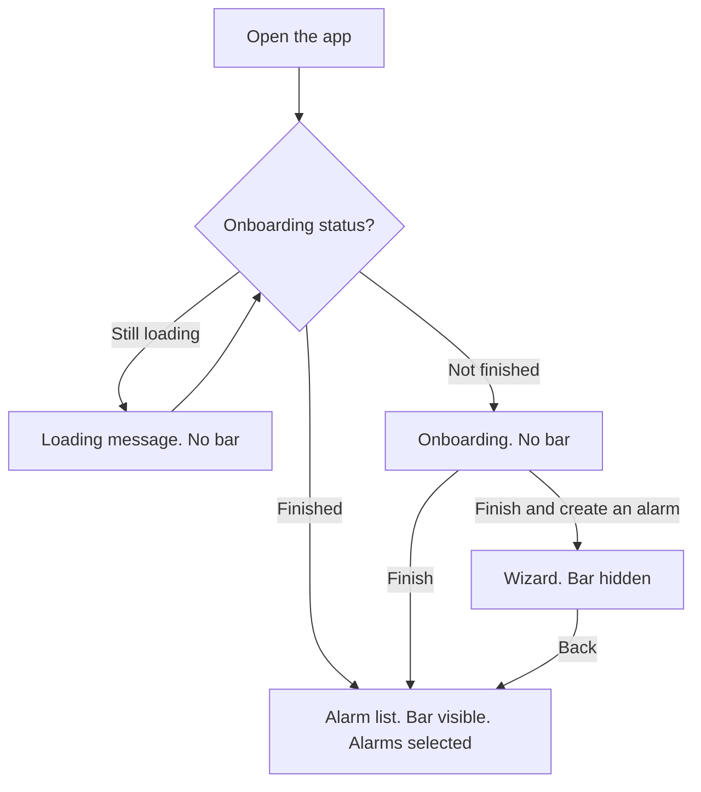
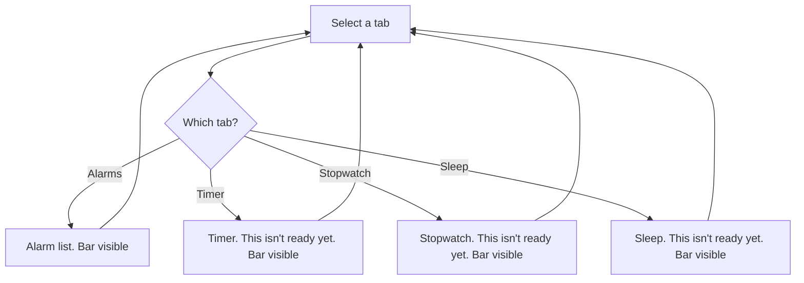
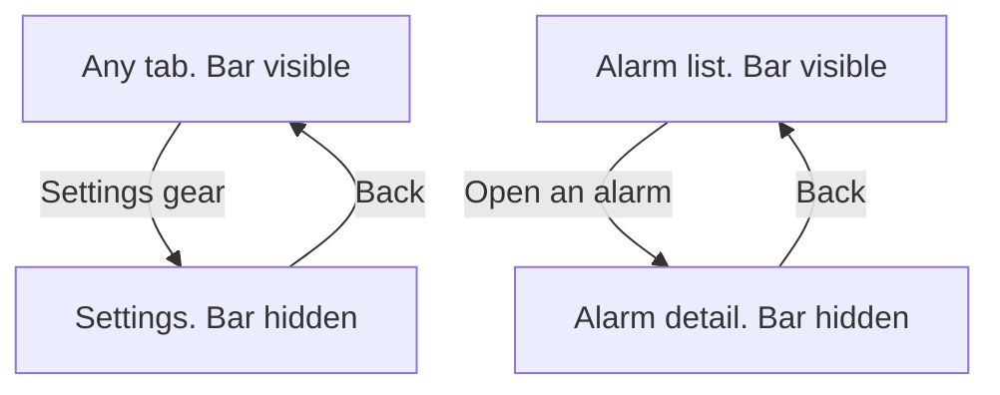
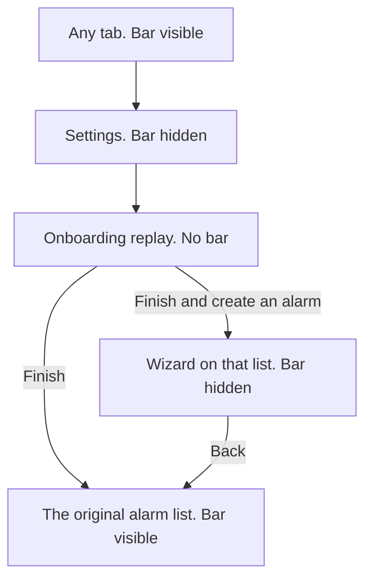

# Home shell

**Date:** 2026-11-11
**Status:** Updated after a Claude review on 2026-11-12. Waiting on a read of this spec before an implementation plan.

The home shell lets LemurLoop show more than alarms. This pass adds the shell only. Timer, stopwatch, and sleep behavior are later work.

## Executive summary

People get a bottom bar with four tabs: Alarms, Timer, Stopwatch, and Sleep. Alarms is the working tab and opens the alarm list that exists today. The other three tabs are visible and each opens a short screen that says the feature is not ready yet. The bar stays on those four screens. It hides when someone opens an alarm, the wizard, chat, or Settings, and it comes back when they return to a tab. Replaying onboarding from Settings returns to that one alarm list, and system Back from there does not reopen Settings. The existing sleep-tracking screen stays in the app and is not opened from the Sleep tab.

## User flows

Onboarding status decides whether the bar exists. The loading message and onboarding have no bar. Finishing onboarding opens the alarm list with the bar. If that finish goes straight into creating an alarm, the wizard covers the bar until the person comes back to the list.

Choosing a tab keeps the bar on screen. Alarms shows the list. Timer, Stopwatch, and Sleep show the not-ready screen for that tab, with that tab selected. Another tab is the way back.

The settings gear is on every tab. Settings, an open alarm, the wizard, and chat cover the bar. Back from Settings returns to the tab that opened it. Back from an alarm returns to the alarm list with the bar visible. System Back from Timer, Stopwatch, or Sleep returns to the alarm list. System Back from the alarm list leaves the app. Tapping the tab that is already selected does not add a second copy of it.

Replaying onboarding from Settings clears every screen above the original alarm list, including Settings and whichever tab was open. The finish lands on that same list. It does not push a second one. Choosing to create an alarm then opens the wizard on that list.

## Decisions

- Four bottom tabs, in this order: Alarms, Timer, Stopwatch, Sleep.
- The app opens on Alarms after onboarding. If onboarding finishes by creating an alarm, the wizard covers the bar until the person comes back to the list.
- Timer, Stopwatch, and Sleep each open a short screen that says the feature is not ready yet. The tab bar stays visible, and another tab is the way back.
- The settings gear stays on the top bar of each tab. Settings is not a fifth tab.
- The bar is hidden on every screen that is not one of those four tabs.
- The existing sleep start/stop screen stays in the project and is not opened from the Sleep tab.
- Each tab has one destination field. The navigation graph shows that destination. There is no second availability flag.
- Replay from Settings returns to the original alarm list and removes every screen above it. A second alarm list is not pushed.
- `MainScreen` applies the scaffold padding and consumes it, including the home bar. Tab scaffolds add none of those insets. Other screens keep their current padding calls. Those calls then see no remaining system insets, so their visible padding can shrink.
- The selected tab is the one whose route equals the current destination route.
- Each `HomeTab` route is the matching `Screen` route.
- The home bar appears and disappears with no animation.

A feature hub was set aside because it adds a tap before the alarm list. A chip row on the alarm list was set aside because the chips read as filters for that list.

## What the person sees

After onboarding, the alarm list is unchanged: centered title "LemurLoop" (`alarm_list_title`), settings gear, add button, and the current list. A bottom bar sits under it. Alarms is selected.

Timer, Stopwatch, and Sleep replace the list with one shared unavailable screen. That screen has a centered title (the tab name), the same settings gear, and the sentence "This isn't ready yet." It has no other actions. The selected tab stays selected.

Opening an alarm, the wizard, chat, or Settings covers the bar. Those screens keep their own back controls. Onboarding, including replay from Settings, has no bar. The ringing alarm and the wake-up check are separate activities and have no bar.

The bar follows layout direction. In Hebrew it mirrors, so Alarms is the rightmost tab. Each tab uses the default `NavigationBarItem` label. The bar appears and disappears by adding or removing the `bottomBar` slot. It does not animate.

## Structure

`MainScreen` owns the bar. The navigation graph stays one flat `NavHost`. Tab screens keep their own scaffolds for the top bar. Alarm list, wizard, chat, and Settings are not given a second bar.

`MainScreen`'s `Scaffold` keeps the default `contentWindowInsets`. Its `bottomBar` slot holds the home bar while `showsHomeBar` is true, and is empty otherwise. The content around the `NavHost` uses `Modifier.padding(innerPadding).consumeWindowInsets(innerPadding)`. That padding is the system bars plus the home bar when the bar is showing. Consuming it leaves no system inset for a descendant to apply again.

Each tab `Scaffold` sets `contentWindowInsets = WindowInsets(0)`. Wizard, chat, Settings, alarm detail, and onboarding keep the padding calls they have today, whether that is a `Scaffold`, `statusBarsPadding()` and `navigationBarsPadding()`, or chat's `imePadding()`. After the shell consumes `innerPadding`, those calls see no remaining system insets. On a device where those insets were previously applied twice, the visible padding on those screens shrinks even though this pass does not edit their layout code. None of those screens get a home bar.

The app targets API 35 and does not call `enableEdgeToEdge`. On Android 15 and newer the platform draws edge to edge, so those insets are real. On older versions the same modifiers often measure zero. The manual check covers both.

Tabs are one list, `HomeTab`, in `ui/navigation`. `HomeDestination` is `AlarmList` or `Unavailable`. That field is the only destination contract.

| Tab | Route | Icon | Destination |
| --- | --- | --- | --- |
| Alarms | `alarm_list` | `Icons.Filled.Alarm` | `AlarmList` |
| Timer | `timer` | `Icons.Filled.Timer` | `Unavailable` |
| Stopwatch | `stopwatch` | `Icons.Filled.AvTimer` | `Unavailable` |
| Sleep | `sleep` | `Icons.Filled.Bedtime` | `Unavailable` |

`Screen` gains `Timer`, `Stopwatch`, and `SleepTab`. `SleepTab.route` is `sleep`. The existing `SleepTracking.route` stays `sleep_tracking`. Each `HomeTab` route is the matching `Screen` constant: `Screen.AlarmList.route`, `Screen.Timer.route`, `Screen.Stopwatch.route`, and `Screen.SleepTab.route`. The strings in the table are those constants, not a second list.

Each of the four `composable` blocks reads `HomeTab` for its route and branches on `destination`. `AlarmList` shows the existing `AlarmListScreen`. `Unavailable` shows `FeatureUnavailableScreen`. The block does not name `SleepTrackingScreen` or any other screen. A later feature adds a `HomeDestination` value and points that tab at it. The composable keeps reading the field. This pass has one `AlarmList` destination, Alarms.

The bar is drawn from `HomeTab` in list order. A pure function `selectedHomeTab(route: String?): HomeTab?` returns the tab whose route equals `route`, or null. `NavigationBarItem.selected` is true only for that tab. The item uses the tab label as its accessible name. The icon's content description is null so the label is not announced twice. Items keep the default Material 3 touch size. The shell does not remember a selected tab of its own.

`FeatureUnavailableScreen` lives in `ui/screen/home/`. It takes the title string resource and an `onNavigateToSettings` callback. The title uses `CenterAlignedTopAppBar`, same as the alarm list, so the title stays centered. The gear is a top-bar action, same as on the alarm list, so in Hebrew it sits on the left.

A pure function `showsHomeBar(route: String?): Boolean` returns true only when `route` is exactly `alarm_list`, `timer`, `stopwatch`, or `sleep`. The shell passes `currentBackStackEntry.destination.route`, which is the route pattern, and does not walk the back-stack hierarchy. Detail and wizard routes therefore keep the bar hidden even if a later change nests them under Alarms.

Tab selection calls `navigate` with `launchSingleTop = true`, `restoreState = true`, and `popUpTo(Screen.AlarmList.route)` with `saveState = true`. The pop target is the Alarms route. It is not the graph start destination, because a session that began on onboarding keeps onboarding as the graph start after onboarding has already left the back stack. `launchSingleTop` is what keeps a second tap on the selected tab from stacking another copy. System Back from Timer, Stopwatch, or Sleep pops to that alarm list. System Back from the alarm list leaves the app.

That pop target works only while one `alarm_list` entry is on the stack. First-run onboarding already ends that way: it removes the onboarding entry and opens one alarm list, then the wizard when the person chooses to create an alarm. Replay from Settings is the path that can break it. Today, finishing `onboarding_replay` removes only the replay entry and pushes another alarm list, so the stack can be alarm list, tab, Settings, alarm list. Tab navigation then pops to the nearest alarm list and system Back reveals Settings or the earlier tab.

Replay completion pops with `popBackStack(Screen.AlarmList.route, inclusive = false)`. That removes Settings, the tab that opened Settings, and the replay screen, and leaves the original alarm list on top. It does not navigate to `alarm_list` again. If that pop returns false because no alarm list is on the stack, navigate to `alarm_list` with `popUpTo` the graph id inclusive, so the alarm list is the only entry. If the person chose to create an alarm, navigate to `alarm_wizard` after that. The Settings screen itself stays as it is.

No new ViewModel, repository, Room migration, scheduler, or service. The shell has no loading or error state of its own. The existing onboarding-status splash stays, and the bar stays hidden until that status is known.

`SleepTrackingScreen` and `SleepTrackingService` stay as they are. Nothing in the tab list navigates to `sleep_tracking`.

## Copy

Add the same entries to `values/strings.xml`, `values-he/strings.xml`, and `values-iw/strings.xml`.

| Key | English | Hebrew |
| --- | --- | --- |
| `home_tab_alarms` | Alarms | שעון |
| `home_tab_timer` | Timer | טיימר |
| `home_tab_stopwatch` | Stopwatch | סטופר |
| `home_tab_sleep` | Sleep | שינה |
| `feature_unavailable_message` | This isn't ready yet. | זה עדיין לא מוכן. |

`home_tab_alarms` is the tab label. The alarm list title stays `alarm_list_title` ("LemurLoop"). Hebrew "שעון" is the glossary's short label for an alarm. Add Timer = טיימר, Stopwatch = סטופר, and Sleep (short tab) = שינה to `docs/HEBREW-TRANSLATION-GLOSSARY.md`. Add the home bar and the unavailable screen to the manual checklist in `docs/RTL-LOCALIZATION.md`.

## Tests

Java Virtual Machine (JVM) test class `HomeTabsTest` under `app/src/test`:

- `homeTabs_orderAndDestination_matchesShell`: four tabs in the order above, each route equal to `Screen.AlarmList.route`, `Screen.Timer.route`, `Screen.Stopwatch.route`, or `Screen.SleepTab.route`, Alarms destination is `AlarmList`, the other three are `Unavailable`, and the Sleep route is different from `sleep_tracking`.
- `showsHomeBar_tabRoute_true` for each of the four tab routes.
- `showsHomeBar_otherRoute_false` for null, `alarm_detail?alarmId={alarmId}`, `settings`, `onboarding`, `onboarding_replay`, `lemur_chat`, `alarm_wizard`, `help`, `about`, `diagnostic_logs`, and `sleep_tracking`.
- `selectedHomeTab_route_matchesThatTab` for each of the four tab routes.
- `selectedHomeTab_otherRoute_null` for the same non-tab routes as `showsHomeBar_otherRoute_false`.

These tests lock the table, the bar predicate, and which tab is selected. They do not run Compose. The app module already depends on `androidx.ui.test.junit4` for instrumented tests. There is no `androidTest` suite and no Navigation testing dependency. This pass does not add that harness. A graph block that ignores `HomeTab.destination` can still pass. The manual check below is the contract for that wiring.

Manual check, in English and in Hebrew. Run it on one device or emulator with API 35 or newer, once with gesture navigation and once with 3-button navigation, and on one device or emulator with API 34 or older.

- The app opens on the alarm list with Alarms selected and the other three tabs unselected. The add button keeps its normal margin above the home bar, with no second gap. The title is not pushed down by a second status-bar inset.
- Opening Timer, Stopwatch, and Sleep each shows that tab's unavailable sentence, and exactly that tab is selected. Sleep has no start or stop control.
- On Timer, Stopwatch, and Sleep, the settings gear opens Settings and the bar is hidden. Back returns to that same tab, with that tab selected and the bar visible.
- Opening an alarm hides the bar. Back returns to the alarm list with the bar visible and Alarms selected.
- System Back from Timer returns to the alarm list. System Back from the alarm list leaves the app.
- Tapping the already selected tab, once for each of the four tabs, does not stack a second copy of that screen.
- From Timer, open Settings, replay onboarding, and finish. The alarm list is showing, the bar is visible, and system Back does not open Settings.
- The same path, choosing to create an alarm, opens the wizard. Back from the wizard shows one alarm list with the bar visible.
- Finish first-run onboarding, open Timer, and press system Back. The alarm list is showing. System Back again leaves the app. From Timer, tap Alarms, then system Back leaves the app. From Timer, open Stopwatch, then system Back returns to the alarm list.
- From chat, open Settings, replay onboarding, and finish. One alarm list is showing, and system Back does not open Settings or chat.
- On the wizard, alarm detail, Settings, and onboarding, the top content sits below the status bar and the bottom content sits above the navigation bar, with no second copy of that inset. In chat, open the keyboard. The input stays above the keyboard, and the list is not padded by a second status bar.
- Hebrew mirrors the bar, so Alarms is the rightmost tab. Titles stay centered, and the Hebrew strings above are the ones on screen. The bar does not animate in or out.

## Out of scope

Timer, stopwatch, and sleep behavior. Removing `SleepTrackingScreen`. Changing alarm creation, chat, scheduling, or the Settings screen. A badge on unavailable tabs. A new searchable setting. A new Compose or navigation test harness.

## Review

Codex reviewed this spec on 2026-11-12. The four-tab choice stayed locked. These edits come from findings that match the current navigation graph:

| Finding | Verdict | Change |
| --- | --- | --- |
| Replay from Settings can leave a second alarm list above Settings | Confirmed | Replay pops back to the original alarm list |
| The JVM tests do not prove the bar or the Sleep screen are wired | Confirmed | Manual checks cover those paths. No new test harness in this pass |
| `available` and the graph can disagree | Confirmed | One `destination` field, and each tab composable reads it |
| Nested scaffolds can pad twice | Risk, not run on a device | First pass gave the outer scaffold the insets. The second pass below replaces that rule |

A second Codex pass the same day checked those edits. Replay and the Navigation 2.5.1 calls stayed sound. These three gaps were real:

| Finding | Verdict | Change |
| --- | --- | --- |
| "Only MainScreen applies system insets" contradicts screens that still pad themselves | Confirmed | The shell applies `padding` and `consumeWindowInsets`. The Claude pass below records that this can shrink visible padding on other screens |
| The manual checklist does not require every tab to show as selected | Confirmed | Each tab must be the selected one, including after Back from Settings, and a second tap must not stack a copy |
| The spec says the repo has no Compose test library | Confirmed | Name `androidx.ui.test.junit4`. There is still no `androidTest` suite and no Navigation testing dependency |

Claude Sonnet, through the Cursor agent, reviewed this spec the same day. Navigation and replay stayed sound. These gaps were real:

| Finding | Verdict | Change |
| --- | --- | --- |
| Consuming insets can shrink padding on screens this pass does not edit | Confirmed in code, not on a device | Say so. Check the wizard, chat with the keyboard open, alarm detail, Settings, and onboarding |
| The gap check means different things before and after Android 15 | Confirmed for `targetSdk` 35 and no `enableEdgeToEdge` call. Not run on a device | Run the manual check on API 35 or newer, gesture and 3-button, and on API 34 or older |
| The checklist skips the back-stack cases that justify `popUpTo(alarm_list)` | Confirmed | Add first-run Back, Alarms from another tab, Stopwatch from Timer, and replay from chat |
| Selection is not defined as a route match, and `HomeTab` routes can drift from `Screen` | Confirmed | `selectedHomeTab(route)` and a test that each tab route is the matching `Screen` route |
| The bar's appearance is unspecified | Risk | The bar is not animated |
