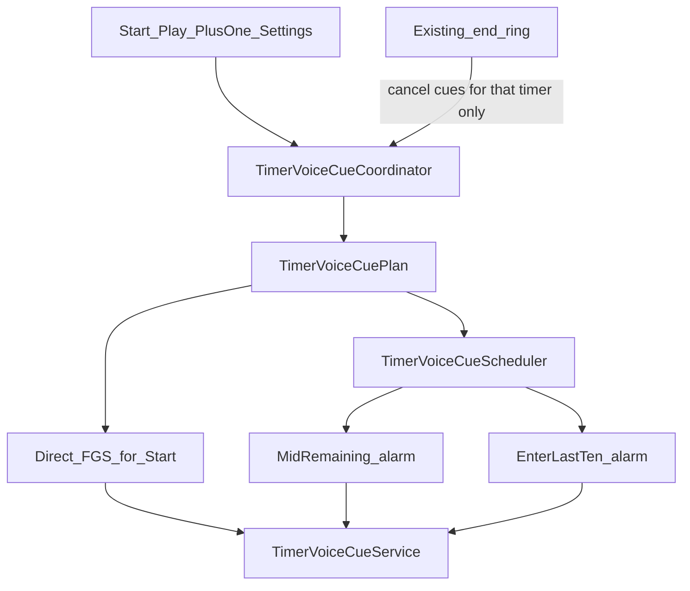

# Timer voice cues

**Date:** 2026-11-19  
**Status:** Amended after Stage 1–3 fan-out. Ready for implementation-plan review (not code yet).  
**Slug:** Cursor / Composer (brainstorm + Stage 2 meta).  
**Research:** [timer-voice-cues Stage 1–2](../../product/research/timer-voice-cues/)

Optional spoken progress for countdown timers. Quiet by default. Does not change the zero-time ring. Stopwatch callouts and Cloud Text-to-Speech (TTS) are out of this slice.

Extends [2026-11-12-timer-design.md](2026-11-12-timer-design.md). Timers remain separate from morning alarms: no briefing, buddy Short Message Service (SMS), math, or smile on a timer.

## Stage 3 product gates (locked 2026-11-19)

| # | Gate | Lock |
|---|---|---|
| 1 | Master vs per-timer On | Master is a **hard kill switch**. If master is off, no cues speak even when a timer override is On. Overrides only refine behavior when master is on. |
| 2 | Resume Start | **Configurable.** Setting “Announce on resume” defaults **on**. When on, pause→play speaks Start; when off, resume is silent. Create-and-start / duplicate always may speak Start (subject to short-timer rules). |
| 3 | Short timer | If Start and LastTen both effective and remaining is too short for both, **LastTen wins**; Start is suppressed. |
| 4 | Mid-run cue | Scheduled at **half of remaining** on each replan. Spoken copy is the **time left** at fire (e.g. “5 minutes left”), **not** the word “halfway”. |
| 5 | Missing Hebrew TTS voice | **Fall back to English** speech (and log). |
| 6 | Duplicate | **Copy** per-timer voice overrides onto the new timer. |
| 7 | Mute / DND audibility | **Alarm-adjacent** audio attributes (try to be heard under mute / Do Not Disturb (DND) where the platform allows). Document platform limits. |
| 8 | Foreground Service (FGS) type | **`mediaPlayback`**, with a short manifest/docs justification (same family as `TimerRingService`). |
| 9 | Last-10 scope | **Keep last-10** as V1 promise. Degrade to Start + mid remaining-callout only after a failed device proof on API 34/35 — do not pre-cut. |

## Product locks

| Decision | Lock |
|---|---|
| Role | Optional accessibility / convenience layer on the existing timer UI |
| Surfaces | Countdown timer only; stopwatch later |
| When cues fire | App open **and** screen off / background |
| Cue set | Start; mid remaining-time callout; last-10 second countdown |
| Voice | Dedicated on-device Android TTS in the cue service (never Cloud TTS; never morning `TtsEngine` / persona) |
| Defaults | Master off; when master is on, the three cue types default on; announce-on-resume defaults on |
| Settings | Global master + three independent cue toggles + announce-on-resume + per-timer Inherit / On / Off per cue type |
| Short / collide | Skip past or colliding cues; speech-budget clearance before last-10; LastTen beats Start when both cannot fit |
| Architecture | Hybrid: exact cue alarms (no `setAlarmClock`) + short `mediaPlayback` FGS; Start from foreground app may start the FGS directly |

## What the user hears

Utilitarian copy from string resources (English + Hebrew in `values`, `values-he`, `values-iw`). Resolve locale from app language setting inside the cue service (not `Locale.getDefault()` alone). If Hebrew TTS data is missing, fall back to English speech and log.

| Cue | Copy |
|---|---|
| Start | `Timer started`, or `{label} started` when the label is non-blank |
| Mid remaining | Spoken remaining duration at fire time (e.g. `5 minutes left`, `30 seconds left`); optional `{label}, …` prefix when label non-blank. Never the word “halfway”. |
| Last-10 | Spoken integers `10` … `1`, or only the remaining seconds if fewer than 10 left |

No flourish, no Gemini script, no Cloud TTS, no morning persona pitch/rate.

## Effective cues

Master kill switch:

```
if (!master) effective(cue) = false
else effective(cue) = override(cue) ?: globalToggle(cue)
```

- Global master, three cue toggles, and announce-on-resume live in `timer_settings` DataStore (snake_case preference keys, matching existing timer settings).
- Per-timer overrides: three nullable Booleans on the timer row (`null` = Inherit, `true` = On, `false` = Off).
- Pure resolver, unit-tested (include master-off × override-On → false).

## Skip and collide rules

Planner inputs: `nowEpoch`, `endsAtEpoch`, `remainingMillis` (or derived), effective flags, `allowStart`, `announceOnResume` context for play vs create.

- **Mid remaining** fires at `now + remaining/2` (half of **remaining** at plan time). Omit when that epoch would fall inside the last-10 window plus a speech-budget clearance (constant, e.g. several seconds — exact constant locked in the implementation plan / tests). At fire time, speak the **then-current** remaining time, not a frozen “halfway” label.
- **Last-10:** if remaining ≤ 0, omit. If remaining is 1…10 seconds, EnterLastTen runs immediately (or with warm-up lead when scheduled ahead) and only those seconds are spoken. Digits are **anchored to `endsAtEpoch`**: skip a digit if late beyond a small skew; stop before speaking if already at/past end.
- **Start:**
  - Create-and-start / duplicate: `allowStart = true` (subject to LastTen-wins short-timer rule).
  - Pause→play: speak Start only if announce-on-resume is on (and short-timer rules allow).
  - Boot / `TIME_SET` reconcile: never emit Start; re-arm future cues only. Do not invent a “process start” reconcile that does not exist in code today.
- Pause, play, `+1:00`, refresh, delete, dismiss, wipe, **voice-cue** settings/override changes, or ring start → cancel that timer’s cue alarms and stop that timer’s cue work in the FGS, then rebuild when still running.
- Non-cue fields written to `timer_settings` (e.g. ring volume capture) must **not** trigger a cue rebuild.

## Architecture (hybrid)

End ring stays on `AndroidTimerScheduler` → `TimerFiredReceiver` → `TimerRingService` with `setAlarmClock` when exact alarms are allowed. Cue path must **never** call `setAlarmClock`.

When exact alarms are denied, cue scheduling may fall back to `setAndAllowWhileIdle` (inexact). Document that late or dropped cues are possible; receiver must not crash the process if FGS start is refused — catch and log.



### Pure domain

- `TimerVoiceCueResolver` — master kill switch + overrides → effective flags.
- `TimerVoiceCuePlan` — milestones: `Start`, `MidRemaining`, `EnterLastTen` with fire epochs; encodes skip/collide and LastTen-vs-Start.
- Remaining-time format helper for mid callout (testable on JVM).

### Android scheduling and coordinator

- `TimerVoiceCueCoordinator` (name flexible) is the **single** cancel/rebuild entry called from: create/start, play, pause, `+1:00`, refresh, duplicate, undo, delete, wipe, boot/`TIME_SET` reconcile, ring start, and voice-cue settings/override changes — not only `TimerListController`.
- `TimerVoiceCueScheduler`: `setExactAndAllowWhileIdle` when exact allowed; never `setAlarmClock`. URIs `lemurloop://timer-cue/<timerId>/<kind>` (distinct from `lemurloop://timer/<id>`). Request-code uniqueness vs end-fire is largely moot (different component/URI); tests should assert URI/component identity, not invent a fake request-code scheme.
- **Start** from an interactive foreground path: start `TimerVoiceCueService` directly (preserve allow-while-idle quota for mid / last-10).
- `TimerVoiceCueReceiver` starts the FGS for alarm-delivered mid / EnterLastTen. Validate at fire time: timer still Running; end epoch still matches; cue not absurdly late; effective flag still on — else drop.

### Voice cue service

- Own **service-scoped** `TextToSpeech` (not shared `TextToSpeechManager` / `TtsEngine`). Neutral pitch/rate. Locale from app language; Hebrew missing → English fallback + log. Load spoken strings via a configuration-context for that locale.
- FGS type **`mediaPlayback`**; notification id ≠ sleep (2), alarm (111), timer finished (220), timer ring (221).
- `START_NOT_STICKY`. Manifest-registered, not exported.
- `SPEAK_ONCE`: one line, then stop that work; do not `stopSelf` in a way that kills another timer’s in-flight last-10 (per-timer sessions / startId discipline).
- `LAST_TEN`: end-anchored digits; timed `PARTIAL_WAKE_LOCK` while speaking; then idle. The planner schedules `EnterLastTen` `LAST_TEN_WARMUP_LEAD_MILLIS` (1.5 s) before the window so the service and TTS are warm. Each digit is spoken at its own wall-clock time (`TimerLastTenCadence`) with `QUEUE_FLUSH`, minus a measured TTS onset lead, and never waits for the previous digit to finish — chaining on speech completion made the countdown rush and then stall (fixed 2026-11-27).
- Alarm-adjacent audio attributes / focus for audibility (gate 7). Do not mutate `STREAM_ALARM` volume capture used by the ring.
- Ring for timer A cancels only A’s cues.

## Settings and UI

### Timer settings

“Voice cues” block:

1. Master switch (default off) — kill switch.
2. Three cue toggles (Start / Mid remaining / Last-10), enabled only when master on (defaults on).
3. Announce on resume (default on), enabled only when master on.

Settings search: registry + labels + sub-screen route (EN / HE / IW). Preference keys snake_case.

### Per-timer overrides

Focus/detail (not keypad): Inherit / On / Off per cue type. Duplicate copies overrides.

## Data

### DataStore (`timer_settings`)

| Logical field | Default |
|---|---|
| voice cues master | `false` |
| voice cue start | `true` |
| voice cue mid remaining | `true` |
| voice cue last ten | `true` |
| voice cue announce on resume | `true` |

Follow existing `TimerSettings` / repository patterns (snake_case keys).

### Room

Nullable Boolean override columns on `timers` (null / true / false). Migration from live `@Database` version (27 at fan-out time → bump + register). Duplicate copies these fields.

## Failures

| Failure | Behavior |
|---|---|
| TTS init fail | Log; skip utterance |
| Hebrew voice missing | English fallback + log |
| Exact alarms denied / inexact late | Drop stale cues at fire time; no crash on FGS refusal |
| Last-10 service killed | Miss remaining digits; no mid-countdown restart |
| Deep Doze skips mid cue | Acceptable soft miss; document |

## Tests (JVM)

- Resolver: master off × override On → false; resume flag does not affect create-start.
- Planner: mid at half remaining; omit mid when colliding with last-10 + budget; short timer LastTen-only; Start omitted on reconcile; announce-on-resume only affects play path at the coordinator layer (planner gets `allowStart`).
- Remaining-time copy formatting.
- Fire-time drop predicates.
- URI / component identity vs end-fire.

## Out of scope (V1)

- Stopwatch callouts; Cloud TTS; configurable last-N; full-run cue FGS; separate cue volume slider; cross-timer speak queue; online radio.

## Review integration

| Round | Verdict | Spec change |
|---|---|---|
| Fan-out Stage 1 (claude, gemini, glm, muse) | Unanimous adopt-with-amendments | Folded into Architecture, Skip/collide, TTS, coordinator, last-10 anchoring |
| Stage 2 meta (cursor) | Merge: claude spine + gemini TTS/Doze + glm Start-on-resume + muse clarity | Merge map applied |
| Stage 3 gates | User locks 1–9 as above | Product locks + copy + audibility + FGS + scope |

## Implementation note

Do not implement on `feature/voice-challenge` or any dirty unrelated branch. Use a dedicated `feature/timer-voice-cues` worktree from `origin/main` when execution starts.
